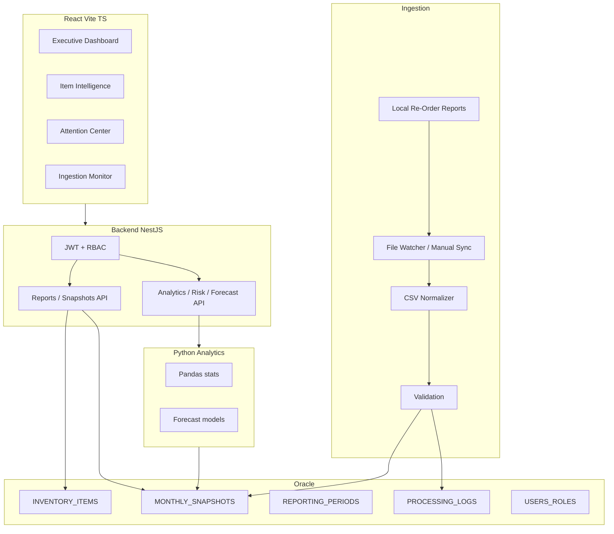

# ROL Inventory Intelligence Platform — Development Plan

**Project:** AI-Powered Inventory Intelligence, Re-Order Level Analytics & Predictive Dashboard  
**Workspace:** `D:\MY FILES\LECO HO IT\Project\Re Order Report`  
**Source folder:** `Re-Order Reports/`  
**Status:** Stage 1 complete — ready for Stage 2+ implementation  

---

## Locked decisions

| Decision | Choice |
|----------|--------|
| Database | Existing **Oracle Database** (LECO server) |
| Authentication (MVP) | Local **JWT + RBAC** |
| Authentication (later) | Microsoft Entra ID |
| Primary stock metric | **Stock Total** |
| Final Stock / ROL Touch | Stored as secondary fields |
| October 2026 | Accepted as **missing** (do not fabricate) |
| MoM stock change | Treated as **net stock change**, not proven consumption |

---

## Stage 1 outcomes (source of truth)

### Available reports

| File | Run Date | Item rows |
|------|----------|-----------|
| `Re-Order Report July 2026.csv` | 22-JUL-2026 | 431 |
| `Re-Order Report August 2026.csv` | 28-AUG-2026 | 431 |
| `Re-Order Report September 2026.csv` | 30-SEP-2026 | 433 (+ `G332A`, `G452G`) |
| `Re-Order Report November 2026.csv` | 15-NOV-2026 | 434 (+ `P715T`) |

- Format: CSV only in this folder  
- No duplicate Item Codes within any file  
- Item Codes must be trimmed; descriptions are formatting-consistent after trim  

### Core fields present

- Item Code, Description, U/M  
- Usage (12-month window), Avg. Usage/M  
- Item Type (`IMP` / `IPM` / `L` / `L2`)  
- Proc. Period, Safety Margin (source spelling: `Safty`)  
- **ROL**, **ROQ**, **Stock Total**  
- Open P/Orders (ops), Yes/No reorder flag  
- Average Cost  
- Quot./Ten./Evalu. (ops), Transfer to Project  
- Final Stock, ROL Touch  
- Project Requirements / Project Quot / Project PO  
- Free-text notes  

### Fields absent (do not invent)

- Opening stock  
- Receipts / issues / consumption transactions  
- Multi-warehouse / branch stock  
- Formal lead-time / safety-stock inputs beyond Proc. Period and Safety Margin  

### Format drift (ingestion must normalize)

- Column renames: `Total Orders (Opr.)` → `Total P/Orders (Opr.)` → `Total P/Orders raised (Opr.)`  
- Usage header: `From …` vs `Usage From …`  
- Jul/Aug: dual Final Stock / ROL Touch blocks; Aug retains stale `Final Stock as at 22.07.26`  
- Aug only: `Actual Req.`  
- Nov: explicit `S/N`; Project Quot in main header  
- Numbers: thousand commas, parentheses negatives, `-` blanks  

---

## Architecture

---

## Tech stack (greenfield in this workspace)

| Layer | Technology |
|-------|------------|
| Frontend | React + Vite + TypeScript + Ant Design + ECharts |
| Backend | NestJS + TypeScript REST API |
| Database | Existing **Oracle** via `oracledb` + TypeORM (Oracle dialect) |
| Auth | Local JWT (access + refresh), bcrypt, RBAC guards |
| Analytics | Python FastAPI sidecar (Pandas / NumPy / scikit-learn) |
| Jobs | NestJS schedule for local folder scan; OneDrive/Graph behind interface |
| Config | `.env` only (Oracle credentials and JWT secrets never exposed to frontend) |
| UI theme | Light corporate; navy primary `#0A2540`; green / amber / red status |

Monorepo layout:

- `apps/web` — React frontend  
- `apps/api` — NestJS API  
- `apps/analytics` — Python forecasting service  
- `docs/` — data dictionary, profiling, architecture, progress  

Docker Compose runs Nest / React / Python locally; Oracle remains the remote existing server.

---

## Oracle schema (normalized, append-only history)

### Identity and security

- `USERS`, `ROLES`, `PERMISSIONS`, `USER_ROLES`, `ROLE_PERMISSIONS`  
- `AUDIT_LOGS`  
- `SYSTEM_CONFIG` (source path, risk thresholds)  

### Ingestion and inventory

- `SOURCE_REPORTS` — filename, hash, run_date, period_key, status, uploaded_at  
- `REPORT_PROCESSING_LOGS` — errors, retry counts  
- `REPORTING_PERIODS` — `period_key` (YYYY-MM), `run_date` (unique)  
- `INVENTORY_ITEMS` — `item_code` PK (trimmed), latest description / UOM / type  
- `MONTHLY_INVENTORY_SNAPSHOTS` — unique `(item_code, period_key)`; **never silently overwrite**  

Snapshot columns (normalized dictionary):

- usage, avg_usage_m, item_type, proc_period, safety_margin  
- rol, roq, stock_total, final_stock, rol_touch  
- po_ops, reorder_flag, avg_cost  
- transfer_to_project, project_req, project_po  
- notes_raw, source_report_id, is_partial  

### Analytics

- `STOCK_METRICS` — MoM delta, pct change, gap_qty, gap_value, status buckets  
- `FORECAST_RESULTS` — method, horizon, predicted values, MAE/RMSE/MAPE, confidence flag  
- `INVENTORY_ALERTS` — attention list cache  
- `AI_INSIGHT_RECORDS` — optional later  

Indexes on `period_key`, `item_code`, stock status flags, and `(item_code, period_key)`.

**Re-import rules:**

- Same file hash → processing log only (duplicate)  
- New hash for same period → admin-explicit reprocess may supersede snapshot  

---

## Report ingestion workflow

1. Scan configurable local path (default: `Re-Order Reports/`).  
2. Detect new/changed files by SHA-256.  
3. Parse LECO CSV: locate Run Date; detect header by `Item Code`; map columns via alias dictionary (Jul–Nov renames).  
4. Validate: required Item Code; parse numbers; reject file if critical parse failure rate exceeds threshold. Incomplete rows (`G332A`, etc.) import with `is_partial=1` and warnings.  
5. Persist period + snapshots in a transaction; write processing log.  
6. Recompute `STOCK_METRICS` for affected periods and neighbors.  
7. Monitor UI: totals, success/fail/duplicate, last sync, per-month availability (show October as **missing**).  

---

## Analytics and forecasting rules

| Type | Rule |
|------|------|
| Actual | Values taken directly from CSV |
| Calculated | MoM delta on Stock Total; gap = max(0, ROL − Stock); gap value = gap × Average Cost; status buckets from configurable thresholds |
| Predicted | Only when ≥3 prior points for an item |

Forecast methods: moving average, weighted moving average, exponential smoothing, linear regression — select by backtest MAE on available history.

- Label forecasts as estimates from **net stock change**, not consumption.  
- Horizons: 1 and 3 months preferred; 6 months only with low-confidence banner (currently only 4 periods).  
- Do not auto-recommend purchase quantities beyond showing ROQ / gap when PO / lead-time context is incomplete.  

---

## Application modules (MVP pages)

1. Login  
2. Executive Dashboard (KPIs + interactive charts; click-through to item/filter)  
3. Monthly Stock Insight Report (sections A–E + PDF/Excel export)  
4. Item Intelligence Dashboard  
5. Inventory Explorer (search / filter / export)  
6. Predictive Analytics  
7. Risk & Attention Center  
8. AI Assistant (rule-based NL over SQL first; optional LLM behind flag using only DB results)  
9. Report Repository  
10. Processing Monitor  
11. User / Role management  
12. Audit Logs  
13. System Configuration (source folder, risk thresholds)  

### Seed roles

- Super Administrator  
- Administrator  
- Management  
- Analyst  
- Viewer  

Enforce on NestJS guards; hide unauthorized UI menu items (frontend hide is not security).

---

## Security

- JWT authentication; bcrypt password hashing; account active/deactive flag  
- RBAC on all APIs and export endpoints  
- Input validation (`class-validator`); parameterized SQL  
- Rate-limit login; audit login and sensitive actions  
- Ingest: allow `.csv` only; enforce file size limits  
- Never expose Oracle credentials, JWT secrets, or Graph tokens to the frontend  

---

## Delivery stages

| Stage | Scope | Status |
|-------|--------|--------|
| 1 | Repository + CSV investigation, data dictionary inputs | **Done** |
| 2 | Architecture docs, scaffold, Oracle DDL | Pending |
| 3 | Auth, RBAC, ingestion pipeline | Pending |
| 4 | Dashboards, monthly insight, explorer, risk | Pending |
| 5 | Predictive analytics | Pending |
| 6 | OneDrive / Graph integration | Pending |
| 7 | Testing and production readiness | Pending |

### Implementation sequence

1. Scaffold monorepo + env templates + progress doc  
2. Oracle DDL + seed admin user/roles  
3. CSV ingestion + monitor against the four real files  
4. Metrics APIs + Executive / Item / Explorer / Risk UI  
5. Monthly insight PDF/Excel exports  
6. Python forecasting service  
7. DB-grounded AI assistant  
8. OneDrive Graph adapter (config-ready)  
9. Keep `docs/DEVELOPMENT_PROGRESS.md` updated each stage  

---

## Explicit non-goals for first release

- Fabricating October or other missing months  
- Treating MoM stock drop as proven consumption  
- Entra ID or production OneDrive until Stage 6  
- Multi-warehouse analysis until source data exists  

---

## Documents to produce

- `docs/DATA_DICTIONARY.md`  
- `docs/DATA_PROFILING.md`  
- `docs/ARCHITECTURE.md`  
- `docs/CALCULATIONS.md`  
- `docs/DEVELOPMENT_PROGRESS.md`  
- This plan: `docs/ROL_INVENTORY_PLATFORM_PLAN.md`  

---

## Implementation checklist

- [ ] Write DATA_DICTIONARY, DATA_PROFILING, ARCHITECTURE, CALCULATIONS docs  
- [ ] Scaffold NestJS API, React Vite web, Python analytics, env templates  
- [ ] Create Oracle DDL, TypeORM entities, seed RBAC + admin user  
- [ ] Implement local JWT auth, RBAC guards, user/role/audit APIs  
- [ ] Implement CSV normalizer + local folder sync + processing monitor  
- [ ] Compute stock metrics and expose dashboard/explorer/risk APIs  
- [ ] Build Executive, Monthly Insight, Item Intelligence, Explorer, Risk UI  
- [ ] PDF/Excel monthly and filtered exports with permission checks  
- [ ] Python forecasting sidecar with backtest metrics and UI  
- [ ] DB-grounded inventory Q&A assistant  
- [ ] Graph/OneDrive adapter interface + config hooks  

---

## Final expected result

A secure, enterprise-grade Inventory Intelligence platform that lets authorized LECO staff analyze monthly ROL stock position, item-level history, critical risks, and forecasts from verified historical CSVs — automatically incorporating each new monthly report while preserving full historical traceability.
